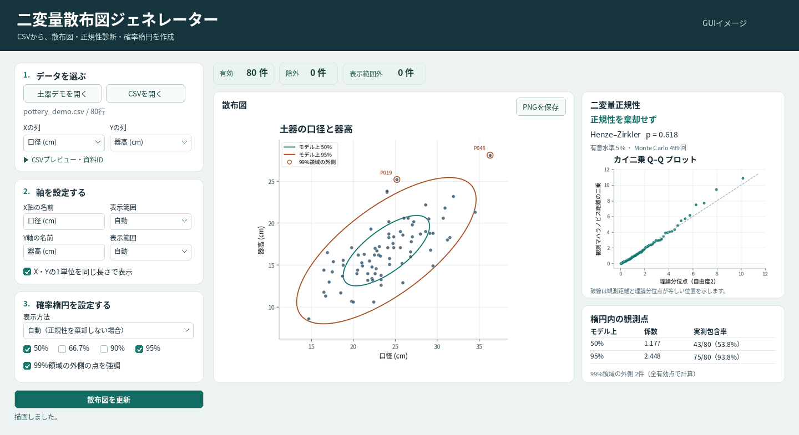
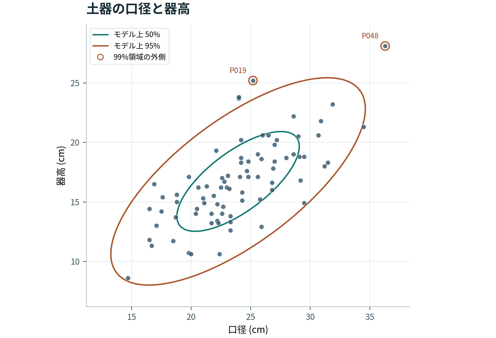
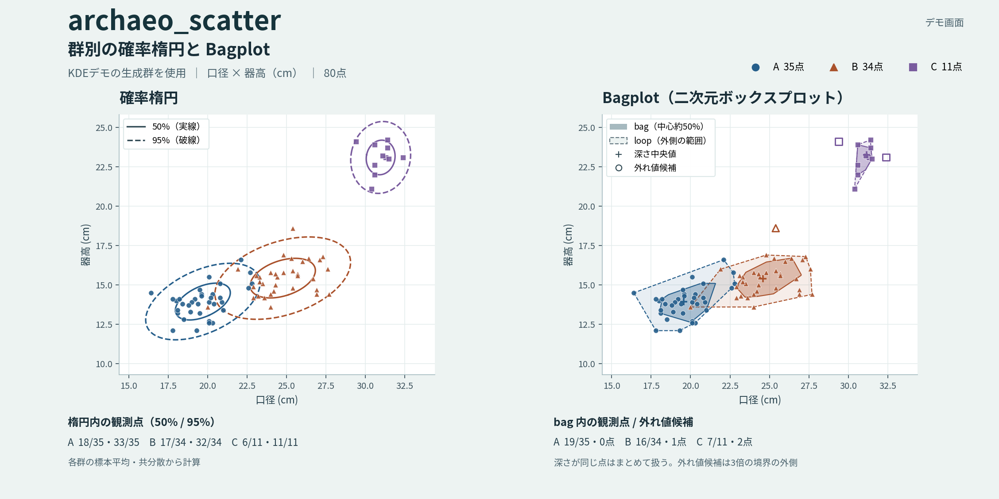
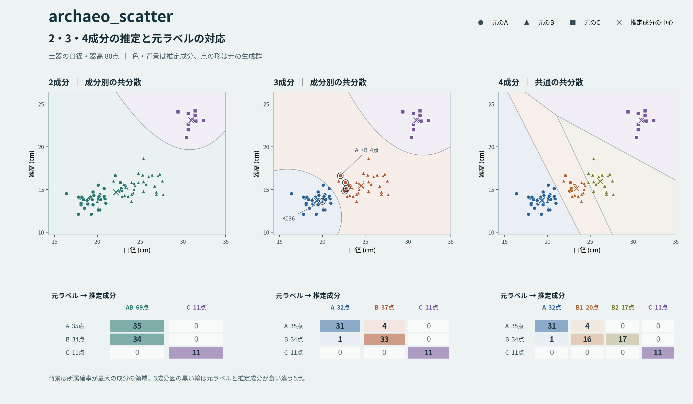

# ArchaeoScatter

考古資料の二つの数値属性を比較する、Python製の散布図ジェネレーターです。土器の口径・器高のほか、石器の長さ・幅など、資料ごとに2変量を記録したCSVを扱えます。GUIは手元のブラウザで開き、CSVはローカルのPythonプロセスで処理します。

| 利用方法 | できること |
|---|---|
| **現行GUI** | CSV読込、X・Y列と資料ID列の選択、軸設定、散布図、二変量正規性診断、確率楕円、PNG保存 |
| **サンプル再現コマンド** | 群別の確率楕円・Bagplot、KDE、GMMの2・3・4成分比較、3成分での再編成前後の比較 |
| **次版GUIの設計** | 元ラベルによる分類表示、分布に応じた重ね描き、クラスターの検証と採用群の編集 |

- [はじめて使う方へ](#setup)
- [サンプル1　正規性と確率楕円](#sample-normal)
- [サンプル2　元の分類、KDE、クラスターの再編成](#sample-mixture)
- [GUI設計](#gui-design)

<a id="setup"></a>
## はじめて使う方へ

[ArtefactsOrthoMaker（AOM）のREADME](https://github.com/kotdijian/ArtefactsOrthoMaker#python-environment)に合わせ、**Pythonの導入 → フォルダの準備 → 初期設定と起動**の順に進めます。Python **3.13.x** を推奨します。各コードブロックのコマンドは、macOSでは「ターミナル」、Windowsでは「PowerShell」に1行ずつ入力します。

### 1. Pythonを導入する

**macOS**

1. [Python公式のmacOSダウンロードページ](https://www.python.org/downloads/macos/)で、Python 3.13系列の **macOS 64-bit universal2 installer** を選びます。Apple SiliconとIntel Macに対応します。
2. ダウンロードした `.pkg` を開き、案内に沿ってインストールします。
3. 新しいターミナルで次を実行し、`Python 3.13.x` が表示されることを確認します。すでに表示される場合はフォルダの準備へ進みます。

```bash
python3.13 --version
```

**Windows**

1. [Python公式のWindowsダウンロードページ](https://www.python.org/downloads/windows/)から **Python install manager** を取得し、`.msix` を開いてインストールします。
2. 新しいPowerShellで次を実行します。すでに `py -3.13 --version` で `Python 3.13.x` が表示される場合はフォルダの準備へ進みます。

```powershell
py install 3.13
py -3.13 --version
```

古いPythonランチャーが先に呼び出されて `py install` が動かない場合は、`pymanager install 3.13`、`pymanager exec -V:3.13 --version` の順に実行します。

### 2. プロジェクトフォルダを準備する

1. [GitHubのリポジトリ](https://github.com/kotdijian/ArchaeoScatter)で **Code → Download ZIP** を選びます。
2. macOSではZIPをダブルクリックし、Windowsでは右クリックして **すべて展開** を選びます。
3. 展開した `ArchaeoScatter-main` を開き、`archaeo_scatter.py` と `requirements.txt` が並ぶフォルダを確認します。以後、このフォルダでコマンドを実行します。Gitを使う場合は `git clone https://github.com/kotdijian/ArchaeoScatter.git` でも取得できます。

### 3. 初期設定と起動

#### macOS

ターミナルに `cd` と半角スペースを入力し、FinderからプロジェクトフォルダをドラッグしてEnterを押します。以下でアプリ専用の仮想環境 `venv` を作り、必要なパッケージを導入します。

```bash
ls
python3.13 -m venv venv
./venv/bin/python -m pip install --upgrade pip
./venv/bin/python -m pip install -r requirements.txt
./venv/bin/python -m pip check
./venv/bin/python archaeo_scatter.py
```

#### Windows / PowerShell

エクスプローラーでプロジェクトフォルダを開き、アドレスバーに `powershell` と入力してEnterを押します。仮想環境のPythonを直接指定して起動します。

```powershell
dir
py -3.13 -m venv venv
.\venv\Scripts\python.exe -m pip install --upgrade pip
.\venv\Scripts\python.exe -m pip install -r requirements.txt
.\venv\Scripts\python.exe -m pip check
.\venv\Scripts\python.exe archaeo_scatter.py
```

手順1で `pymanager exec` を使った場合は、仮想環境の作成を `pymanager exec -V:3.13 -m venv venv` に置き換えます。

**2回目以降**は、同じプロジェクトフォルダで各OSの最後の起動コマンドだけを実行します。画面が自動で開かない場合は、ターミナルに表示された `http://127.0.0.1:...` をブラウザで開きます。終了はターミナルで **Ctrl+C** です。

`ModuleNotFoundError` が出る場合は、仮想環境内のPythonを指定して `-m pip install -r requirements.txt` を再実行してください。図の日本語が四角で表示される場合は、Noto Sans CJK JPなどの日本語フォントを導入してください。

<a id="sample-normal"></a>
## サンプル1　正規性と確率楕円

[pottery_demo.csv](examples/pottery_demo.csv) は、二変量正規モデルから生成した土器の模擬計測80点です。口径の大きい側で器高の散らばりが広く見え、裾の観測値も含む標本を選びました。生成モデルの条件付き分散は一定です。

1. **土器デモを開く**を押します。起動時にも同じデータが表示されます。CSVから試す場合は **CSVを開く**で `examples/pottery_demo.csv` を指定します。
2. Xを **口径 (cm)**、Yを **器高 (cm)** に設定します。CSVから開いた場合は、**CSVプレビュー・資料ID** で **資料ID** を選択します。
3. 表示範囲を両軸とも **自動** にし、**X・Yの1単位を同じ長さで表示**をオンにします。手動軸を試す場合はXの範囲を20〜30 cmにして更新します。表示範囲外の点数が変わり、検定結果と包含数は全80点に対する値を維持します。
4. 表示方法を **自動**、包含確率を **50%・95%** にして **散布図を更新** を押します。二変量正規性は5%水準で棄却されず（Henze–Zirkler、Monte Carlo 499回、p＝0.618）、楕円内にそれぞれ43点、75点が入ります。99%領域外のP019とP048も計算に含まれます。
5. **PNGを保存**を押すと、現在描画している散布図が240 dpiで保存されます。確率は50%、66.7%（正確には2/3）、90%、95%から選択できます。

初期プロトタイプのGUIイメージ



50%・95%確率楕円の出力例



<a id="sample-mixture"></a>
## サンプル2　元の分類、KDE、クラスターの再編成

[archaeo_scatter_kde_demo.csv](examples/archaeo_scatter_kde_demo.csv) は、近接して裾が重なるA（35点）・B（34点）と、少し離れたC（11点）の計80点です。`生成群` 列には模擬データの元ラベルが入っています。

### GUIで全体を見る

1. **CSVを開く**で `examples/archaeo_scatter_kde_demo.csv` を選択します。Xを **口径 (cm)**、Yを **器高 (cm)** にし、必要に応じて資料ID列を指定します。
2. **散布図を更新**を押します。全80点をまとめた正規性検定では p＝0.002 で、現在の自動モードは散布図を表示します。
3. 群別描画、Bagplot、KDE、GMMの比較は、下記の再現コマンドで試せます。

### 比較図を再現する

初期設定と同じプロジェクトフォルダで実行します。出力先は `example-output/` です。最初の1行はサンプル再現用の追加パッケージを導入します。

**macOS**

```bash
./venv/bin/python -m pip install -r examples/requirements.txt
./venv/bin/python -m examples.group_demo
./venv/bin/python -m examples.kde_demo
./venv/bin/python -m examples.gmm_demo
./venv/bin/python -m examples.group_demo --refit
```

**Windows / PowerShell**

```powershell
.\venv\Scripts\python.exe -m pip install -r examples/requirements.txt
.\venv\Scripts\python.exe -m examples.group_demo
.\venv\Scripts\python.exe -m examples.kde_demo
.\venv\Scripts\python.exe -m examples.gmm_demo
.\venv\Scripts\python.exe -m examples.group_demo --refit
```

1. **元の分類を確認する。** `group_demo` は生成群を使い、同じ縮尺で群別の確率楕円とBagplotを比較します。Bagplotの外れ値候補は各群内での位置から求めます。

   

2. **分布のピークを見る。** `kde_demo` は群ラベルを使わずに全80点の密度等高線を描きます。図はScottの帯域幅で3つのピークを示します。帯域幅を1.25倍にした計算ではA・B側のピークが一つにまとまります。

   

3. **2・3・4成分を比較する。** `gmm_demo` はX・Yで推定した所属領域と、元ラベルから推定成分への対応を描きます。2成分ではA＋BとC、3成分では元の3群と75／80点が一致します。図の2・3成分には成分別共分散、4成分には共通共分散を使います。成分数の違いを評価するときは、コマンド出力のBICを同じ共分散設定内で比較してください。

   

4. **再編成案を確認する。** `group_demo --refit` は3成分GMMの推定群（A＝32、B＝37、C＝11点）で楕円とBagplotを再計算します。移動した5点を赤紫のひし形で示します。A→Bは K029、K038、K048、K075、B→Aは K036 です。

   

<a id="gui-design"></a>
## GUI設計

基本の操作順は **CSV読込 → X・Y列の選択 → 散布図と分布診断 → 重ね描きの選択** です。現行GUIの自動表示は、正規性を棄却しない場合に確率楕円を描き、それ以外では散布図を表示します。以下はサンプル再現コードを踏まえた次版のGUI設計です。

### 入力と計算可否

- 1行目を見出しとするカンマ区切りのCSVを使用します。現行GUIはUTF-8／CP932、10 MB以下に対応します。X・Yがともに有限な数値の行を使い、全体・有効・除外の件数を表示します。
- X・Yの有効な組がゼロなら、列選択に戻る案内を出します。1〜4点では散布図を表示し、正規性判定は保留します。5点はアプリ上の運用基準です。少数標本では有効件数とQ–Qプロットも確認します。
- 一定値やほぼ一直線の群では、計算できない重ね描きを停止します。同一座標の行は観測として保持します。次版では除外理由、重複座標の件数、資料IDの重複も確認できるようにします。
- 軸範囲はX・Y別に自動／手動を指定できます。手動範囲は表示だけに適用します。同じ単位のX・Yでは等縮尺を選べます。

### 分布診断と重ね描き

| 自動判定 | 次版の表示案 |
|---|---|
| 二変量正規性を棄却せず | 確率楕円。既定は50%と95% |
| 二変量正規性を棄却 | Bagplot。集中域が複数ある場合はKDEへ切り替えて確認 |
| 判定保留または計算不能 | 散布図と理由 |

手動モードでは **確率楕円／Bagplot／KDE／散布図のみ** を選べるようにします。棄却したデータに楕円を重ねる場合は参考表示です。Henze–Zirkler検定は有意水準5%を既定とし、件数・p値・Q–Qプロットを表示します。現行GUIでは有効点が350点を超える場合、検定だけ固定seedで抽出した350点を使います。

### ラベルを保持して描く

X・Y列に加え、任意の群ラベル列と資料ID列を選びます。元のラベルを使って色と点形を分け、凡例に件数を表示します。空欄は「ラベル未設定」として描きます。重ね描きの自動判定は群別に行い、全群を同じ描画方式に切り替えて比較できるようにします。

### クラスターを検証して再構成する

1. **クラスターを検証**で、成分数の候補、共分散の設定、標準化の有無を指定します。GMMの推定にはX・Yを使用します。
2. 同じ縮尺の散布図とBIC、成分ごとの件数、元ラベルと推定成分の対応表を比較します。統合や分割の候補を示します。
3. 元ラベルとの不一致、低い所属確率、Bagplotの外れ値候補を別々に表示し、資料IDで確認します。成分数の選択と考古学的な分類の採否は独立した判断です。
4. **推定結果を表示**した後、利用者が統合・分割、個体の移動、判定保留を確認し、**採用群に反映**します。
5. 採用群で楕円・Bagplotを再計算し、変更点にIDと方向を表示します。元ラベル、推定成分、採用群、判定理由をCSVに書き出せるようにします。

確率楕円は標本平均・標本共分散を当てはめた正規モデルの包含領域です。Bagplotは半空間深度を近似し、中央のbag、外側のloop、bagを中心から3倍に拡大した境界の外側にある候補点を表示します。

統計手法の参照先 [二変量正規性検定](https://doi.org/10.1080/03610929008830400) · [確率楕円](https://online.stat.psu.edu/stat505/Lesson04) · [Bagplot](https://doi.org/10.1080/00031305.1999.10474494) · [GMMとBIC](https://journal.r-project.org/articles/RJ-2016-021/)

ライセンスは [MIT License](LICENSE) です。
