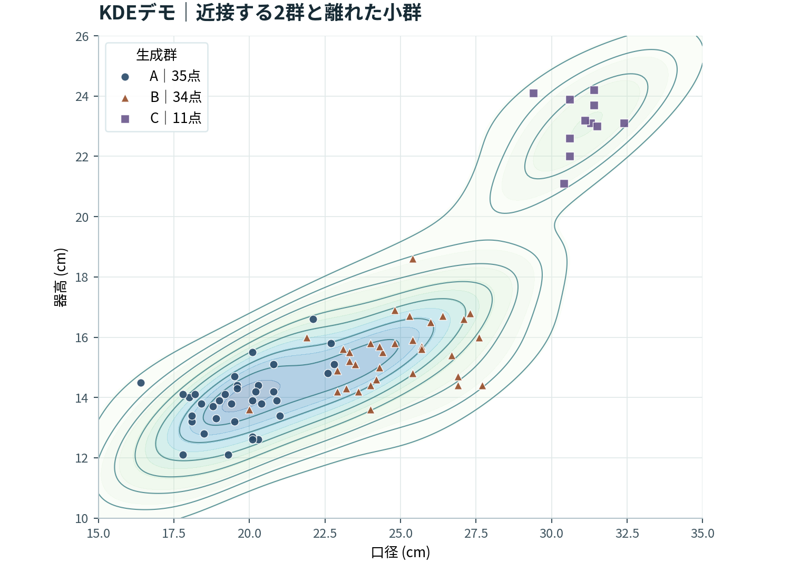
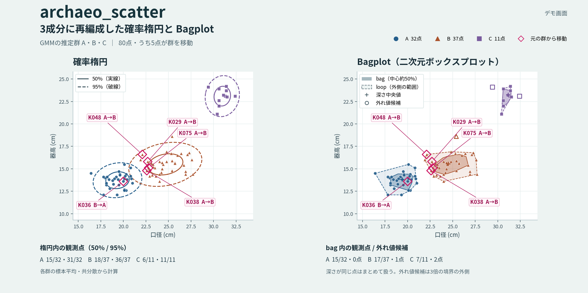

# ArchaeoScatter

考古資料の二つの数値属性を比較する、Python製の散布図ジェネレーターです。土器の口径・器高のほか、石器の長さ・幅など、資料ごとに2変量を記録したCSVを扱えます。GUIは手元のブラウザで開き、CSVはローカルのPythonプロセスで処理します。同じCSVを開いたまま、散布図・正規性診断、密度等高線（KDE）、ガウス混合モデル（GMM）を切り替えられます。

- [はじめて使う方へ](#setup)
- [実行手順と出力](#workflows)
  - [1. 2変量のシンプルなデータを描く](#sample-normal)
  - [2. ラベル付きの2変量データを群別に見る](#sample-mixture)
  - [3. ラベル付きの2変量データの分類を再評価する](#review-labels)
- [GUI設計](#gui-design)

<a id="setup"></a>
## はじめて使う方へ

[ArtefactsOrthoMaker（AOM）のREADME](https://github.com/kotdijian/ArtefactsOrthoMaker#python-environment)に合わせ、**Pythonの導入 → ZIPの展開 → プロジェクトフォルダからPowerShellまたはターミナルを開く → 初期設定と起動**の順に進めます。Python **3.13.x** を推奨します。コマンドは1行ずつ入力し、Enterを押してください。

### 1. Pythonを導入する

#### Windows

スタートメニューからPowerShellを開き、`py -3.13 --version` を実行します。結果が `Python 3.13.` で始まれば **A** と控え、手順2へ進みます。それ以外の場合は `python --version` を実行し、`Python 3.13.` で始まれば **B** と控え、手順2へ進みます。Microsoft Storeが開いた場合は閉じてください。

Python 3.13が使えない場合は、[Python公式のWindowsダウンロードページ](https://www.python.org/downloads/windows/)から **Python install manager** を入手し、`.msix` を開いてインストールします。新しいPowerShellで次を実行し、`Python 3.13.` で始まる表示を確認したら **A** と控えます。

```powershell
py install 3.13
py -3.13 --version
```

古いランチャーが優先されるなどして失敗した場合は、次の2行を実行します。2行目に `Python 3.13.` で始まる表示が出たら **C** と控えます。

```powershell
pymanager install 3.13
pymanager exec -V:3.13 --version
```

#### macOS

ターミナルで `python3.13 --version` を実行し、`Python 3.13.` で始まる表示が出れば手順2へ進みます。使えない場合は、[Python公式のmacOSダウンロードページ](https://www.python.org/downloads/macos/)からPython 3.13系列の **macOS 64-bit universal2 installer** を取得します。`.pkg` を開いてインストールし、新しいターミナルで確認します。

```bash
python3.13 --version
```

### 2. ZIPを展開し、プロジェクトフォルダから開く

1. [GitHubのリポジトリ](https://github.com/kotdijian/ArchaeoScatter)で **Code → Download ZIP** を選びます。
2. WindowsではZIPを右クリックして **すべて展開**、macOSではZIPをダブルクリックします。
3. 展開した `ArchaeoScatter-main` の中で、`archaeo_scatter.py` と `requirements.txt` が並ぶフォルダを確認します。すでにアプリ一式を配置済み、またはGitでクローン済みの場合は、両ファイルが見える既存フォルダを使います。
4. Pythonの導入・バージョン確認とZIPの展開が済んだら、それまで使っていたPowerShellまたはターミナルを閉じ、以下の手順でプロジェクトフォルダから開き直します。

<a id="open-project-shell"></a>
#### WindowsでPowerShellを開く

1. エクスプローラーでプロジェクトフォルダを開きます。
2. 上部のアドレスバーに `powershell` と入力してEnterを押します。
3. 開いたPowerShellで `dir` を実行し、`archaeo_scatter.py` と `requirements.txt` が表示されることを確認します。

#### macOSでターミナルを開く

1. Finderでプロジェクトフォルダを開き、**表示 → パスバーを表示** を選びます。下部にパスバーがあればそのまま進みます。
2. パスバー右端のプロジェクトフォルダ名をControlキーを押しながらクリックし、**サービス → フォルダに新規ターミナル** を選びます。
3. 開いたターミナルで `ls` を実行し、`archaeo_scatter.py` と `requirements.txt` が表示されることを確認します。

両ファイルが表示されなければ、PowerShellまたはターミナルを閉じ、両ファイルの見えるフォルダから開き直してください。[Appleのターミナル操作ガイド](https://support.apple.com/ja-jp/guide/terminal/trmlb20c7888/mac)

### 3. 初期設定と起動

#### Windows / PowerShell

[手順2で開いたPowerShell](#open-project-shell)で、手順1で控えた記号に対応する**1行だけ**を実行して仮想環境 `venv` を作ります。

| 記号 | 実行するコマンド |
|---|---|
| A | `py -3.13 -m venv venv` |
| B | `python -m venv venv` |
| C | `pymanager exec -V:3.13 -m venv venv` |

続いて、バージョン確認、パッケージ導入、起動を行います。

```powershell
.\venv\Scripts\python.exe --version
.\venv\Scripts\python.exe -m pip install --upgrade pip
.\venv\Scripts\python.exe -m pip install -r requirements.txt
.\venv\Scripts\python.exe -m pip check
.\venv\Scripts\python.exe archaeo_scatter.py
```

#### macOS

[手順2で開いたターミナル](#open-project-shell)で実行します。

```bash
python3.13 -m venv venv
./venv/bin/python --version
./venv/bin/python -m pip install --upgrade pip
./venv/bin/python -m pip install -r requirements.txt
./venv/bin/python -m pip check
./venv/bin/python archaeo_scatter.py
```

**2回目以降**も[プロジェクトフォルダから開き](#open-project-shell)、各OSの最後の起動コマンドだけを実行します。ブラウザが自動で開かなければ、PowerShellまたはターミナルに表示された `http://127.0.0.1:...` をブラウザで開いてください。終了はPowerShellまたはターミナルで **Ctrl+C** です。

`ModuleNotFoundError` が出たら、上記の各OSの `-m pip install -r requirements.txt` の行を再実行してください。図の日本語が四角で表示される場合は、Noto Sans CJK JPなどの日本語フォントを導入してください。

<a id="workflows"></a>
## 実行手順と出力

| データと目的 | 現在の操作方法 | 得られる出力 |
|---|---|---|
| 2変量の関係や広がりを見る | GUI | 散布図、正規性診断、確率楕円、散布図のPNG |
| ラベル付きの2変量を元の群別に比較する | 付属デモコマンドで確認 | 元ラベル別の確率楕円・Bagplotの比較PNG |
| ラベル付きの2変量から元の分類を再評価する | GUIでKDEとGMMを確認し、付属デモコマンドで元ラベルと比較 | 密度等高線、成分数ごとのBIC、推定成分で色分けした散布図、元ラベルとの比較PNG |

現行GUIでは任意のCSVでKDEとGMMを実行できます。元ラベルによる群別表示と、推定成分を元ラベルに照合する図は、付属コマンドでサンプル2を使って再現できます。

<a id="sample-normal"></a>
### 1. 2変量のシンプルなデータを描く

**出力**　GUIに散布図、正規性の判定とQ–Qプロット、楕円内の観測点数を表示します。**PNGを保存**で、表示中の散布図を240 dpiのPNGとしてブラウザからダウンロードできます。

1. **CSVを開く**でデータを読み込み、X軸・Y軸に使う数値列を選びます。資料番号がある場合は **CSVプレビュー・資料ID** で指定できます。
2. 軸の表示範囲を自動または手動で設定します。両軸の単位が同じ場合は **X・Yの1単位を同じ長さで表示** を選べます。手動の範囲指定は表示に適用されます。
3. 図の上の **散布図・正規性診断** を選び、楕円の表示方法を **自動** にして **図を更新** を押します。二変量正規性を棄却しない場合に確率楕円が表示されます。50%・66.7%（2/3）・90%・95%から水準を選べます。散布図を確認して **PNGを保存** を押します。

#### サンプルデータを使用する場合（サンプル1）

起動後に **CSVを開く** を押し、プロジェクトフォルダ内の [examples/pottery_demo.csv](examples/pottery_demo.csv) を選びます。Xを **口径 (cm)**、Yを **器高 (cm)**、資料IDを **資料ID** に設定し、両軸を自動範囲・等縮尺にします。表示方法を **自動**、水準を **50%・95%** にして更新します。

有効80点で正規性を棄却せず（Henze–Zirkler、p＝0.618）、50%楕円内に43点、95%楕円内に75点が入ります。99%領域外のP019・P048も計算対象です。Xの表示範囲を手動で20〜30 cmに変えると表示される点は変わりますが、診断と楕円内の集計は全80点で行います。


<a id="sample-mixture"></a>
### 2. ラベル付きの2変量データを群別に見る

**出力**　元のラベルで色分けした散布図に、各群の確率楕円とBagplotを重ねた比較PNGです。群ごとの位置・広がり・重なりと、群内の外れ値候補を確認できます。

1. X・Yに使う数値列と、群を示すラベル列を確認します。元の分類を確認する段階では、そのラベルで点を分けます。
2. 元ラベル別の分布を同じ軸・縮尺で比較します。初めに全点を表示して群間の重なりを見たうえで、各群の楕円とBagplotを照合します。

#### デモ　サンプル2の元のA・B・Cを比較する

[archaeo_scatter_kde_demo.csv](examples/archaeo_scatter_kde_demo.csv) は、口径・器高と `生成群` を持つ80点です。A（35点）とB（34点）の裾が重なり、C（11点）は少し離れています。GUIで読み込むと、全80点の散布図と正規性診断（p＝0.002）を確認できます。

群別の比較図は、[プロジェクトフォルダから開き直したPowerShellまたはターミナル](#open-project-shell)で次を実行します。1行目の追加パッケージ導入は初回だけです。

**Windows / PowerShell**

```powershell
.\venv\Scripts\python.exe -m pip install -r examples/requirements.txt
.\venv\Scripts\python.exe -m examples.group_demo
```

**macOS**

```bash
./venv/bin/python -m pip install -r examples/requirements.txt
./venv/bin/python -m examples.group_demo
```

`example-output/archaeo_scatter_group_demo.png` を開きます。左の楕円と右のBagplotで、A・Bの重なりやCのまとまりを見比べられます。


<a id="review-labels"></a>
### 3. ラベル付きの2変量データの分類を再評価する

**出力**　全体の密度等高線、GMMの2・3・4成分の比較図と元群から推定成分への対応件数、3成分で再編成した場合の群別の確率楕円・Bagplotです。最後の図は、変更候補を資料IDと移動方向で示します。

1. **密度の集中を見る。** X・Yの全点からKDEを求め、元の分類に照らして集中域と群の重なりを確認します。
2. **候補を比較する。** X・Yで推定したGMMの成分を元ラベルと照合します。BICと対応件数を見て、統合や分割の候補を比較します。
3. **再編成案を点検する。** 候補の分類で確率楕円とBagplotを再計算し、変更点を資料IDで確認します。分類の採否は、器形・文様・出土状況などの資料情報も合わせて判断します。

#### GUIで散布図からKDE・GMMへ進む

Gitで取得した場合はプロジェクトフォルダで `git pull`、ZIPで取得した場合は最新版のZIPを展開してください。以前の環境を更新した場合は、初期設定の `-m pip install -r requirements.txt` を再実行し、アプリを起動し直してください。

1. **CSVを開く**でサンプル2（または手元のCSV）を選び、X・Y列を設定します。初期状態の **散布図・正規性診断** で全体を確認します。
2. 図の上の **密度等高線（KDE）** を押すと、同じCSVで直ちに図が切り替わります。帯域幅はScottの基準を1とした倍率です。サンプル2では **1.00** と **1.25** を試し、A・B付近の集中域の見え方を比べます。帯域幅を変えた後は **図を更新** を押します。
3. 図の上の **成分数の比較（GMM）** を押すと、散布図とBIC表が表示されます。初期設定の共分散は **成分ごと** です。BIC表には、データ件数と収束状況に応じて最大6成分まで表示されます。**自動（BIC最小）** は、その共分散設定でBICが最小のモデルを描きます。
4. BIC表の **2 → 3 → 4** を順に押して、描画を切り替えます。点の色と凡例の件数で割り当てを比較します。さらに共分散を **全成分で共通** に切り替えて **図を更新** を押すと、共分散の設定による違いも確認できます。
5. **PNGを保存**で現在表示中の図を保存できます。他の表示へ切り替えても、読み込んだCSVとX・Y列、軸設定を引き継ぎます。

KDEとGMMの実行には、二次元に広がる有効点が5点以上必要です。成分番号はそのモデル内の識別子です。元ラベルとの対応は、サンプル2を使った次の比較図で確認できます。

#### デモ　サンプル2を3成分の再編成案と比較する

[手順2](#sample-mixture)で追加パッケージを導入した後、同じプロジェクトフォルダで実行します。コマンドは順に、密度等高線、成分比較、再編成案の図を `example-output/` に作ります。

**Windows / PowerShell**

```powershell
.\venv\Scripts\python.exe -m examples.kde_demo
.\venv\Scripts\python.exe -m examples.gmm_demo
.\venv\Scripts\python.exe -m examples.group_demo --refit
```

**macOS**

```bash
./venv/bin/python -m examples.kde_demo
./venv/bin/python -m examples.gmm_demo
./venv/bin/python -m examples.group_demo --refit
```

1. **`archaeo_scatter_kde_demo.png`** を開きます。Scottの帯域幅では3つのピークが見え、1.25倍ではA・Bのピークが一つにまとまります。

   

2. **`archaeo_scatter_gmm_comparison.png`** を開きます。2成分ではA＋BとC、3成分では元の3群と75／80点が一致します。図では2・3成分に成分別共分散、4成分に共通共分散を使用しています。成分数の違いは、コマンド出力のBICを同じ共分散設定内で比較してください。

   

3. **`archaeo_scatter_gmm3_reclustered.png`** を開きます。推定群はA＝32、B＝37、C＝11点です。赤紫のひし形は変更候補5点で、A→BがK029・K038・K048・K075、B→AがK036です。入力CSVの元ラベルは保持されます。

   

<a id="gui-design"></a>
## GUI設計

基本の操作順は **CSV読込 → X・Y列の選択 → 散布図と分布診断 → 重ね描きの選択** です。現行GUIでは、散布図の自動表示で正規性を棄却しない場合に確率楕円を描きます。KDEとGMMには同じ画面から切り替えられます。以下は群別描画・再分類を含むGUI設計です。

### 入力と計算可否

- 1行目を見出しとするカンマ区切りのCSVを使用します。現行GUIはUTF-8／CP932、10 MB以下に対応します。X・Yがともに有限な数値の行を使い、全体・有効・除外の件数を表示します。
- X・Yの有効な組がゼロなら、列選択に戻る案内を出します。1〜4点では散布図を表示し、正規性判定は保留します。5点はアプリ上の運用基準です。少数標本では有効件数とQ–Qプロットも確認します。
- 一定値やほぼ一直線の群では、計算できない重ね描きを停止します。同一座標の行は観測として保持します。次版では除外理由、重複座標の件数、資料IDの重複も確認できるようにします。
- 軸範囲はX・Y別に自動／手動を指定できます。手動範囲は表示だけに適用します。同じ単位のX・Yでは等縮尺を選べます。

### 分布診断と重ね描き

| 自動判定 | 次版の表示案 |
|---|---|
| 二変量正規性を棄却せず | 確率楕円。既定は50%と95% |
| 二変量正規性を棄却 | Bagplot。集中域が複数ある場合はKDEへ切り替えて確認 |
| 判定保留または計算不能 | 散布図と理由 |

手動モードでは **確率楕円／Bagplot／KDE／散布図のみ** を選べるようにします。棄却したデータに楕円を重ねる場合は参考表示です。Henze–Zirkler検定は有意水準5%を既定とし、件数・p値・Q–Qプロットを表示します。現行GUIでは有効点が350点を超える場合、検定だけ固定seedで抽出した350点を使います。

### ラベルを保持して描く

X・Y列に加え、任意の群ラベル列と資料ID列を選びます。元のラベルを使って色と点形を分け、凡例に件数を表示します。空欄は「ラベル未設定」として描きます。重ね描きの自動判定は群別に行い、全群を同じ描画方式に切り替えて比較できるようにします。

### クラスターを検証して再構成する

1. **クラスターを検証**で、成分数の候補、共分散の設定、標準化の有無を指定します。GMMの推定にはX・Yを使用します。
2. 同じ縮尺の散布図とBIC、成分ごとの件数、元ラベルと推定成分の対応表を比較します。統合や分割の候補を示します。
3. 元ラベルとの不一致、低い所属確率、Bagplotの外れ値候補を別々に表示し、資料IDで確認します。成分数の選択と考古学的な分類の採否は独立した判断です。
4. **推定結果を表示**した後、利用者が統合・分割、個体の移動、判定保留を確認し、**採用群に反映**します。
5. 採用群で楕円・Bagplotを再計算し、変更点にIDと方向を表示します。元ラベル、推定成分、採用群、判定理由をCSVに書き出せるようにします。

確率楕円は標本平均・標本共分散を当てはめた正規モデルの包含領域です。Bagplotは半空間深度を近似し、中央のbag、外側のloop、bagを中心から3倍に拡大した境界の外側にある候補点を表示します。

統計手法の参照先 [二変量正規性検定](https://doi.org/10.1080/03610929008830400) · [確率楕円](https://online.stat.psu.edu/stat505/Lesson04) · [Bagplot](https://doi.org/10.1080/00031305.1999.10474494) · [GMMとBIC](https://journal.r-project.org/articles/RJ-2016-021/)

ライセンスは [MIT License](LICENSE) です。
